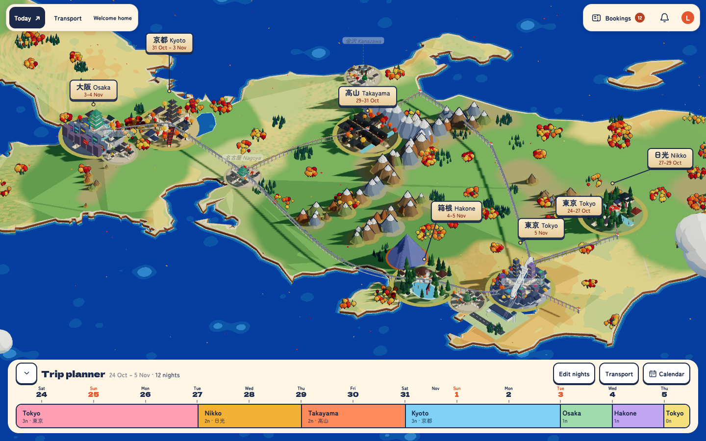
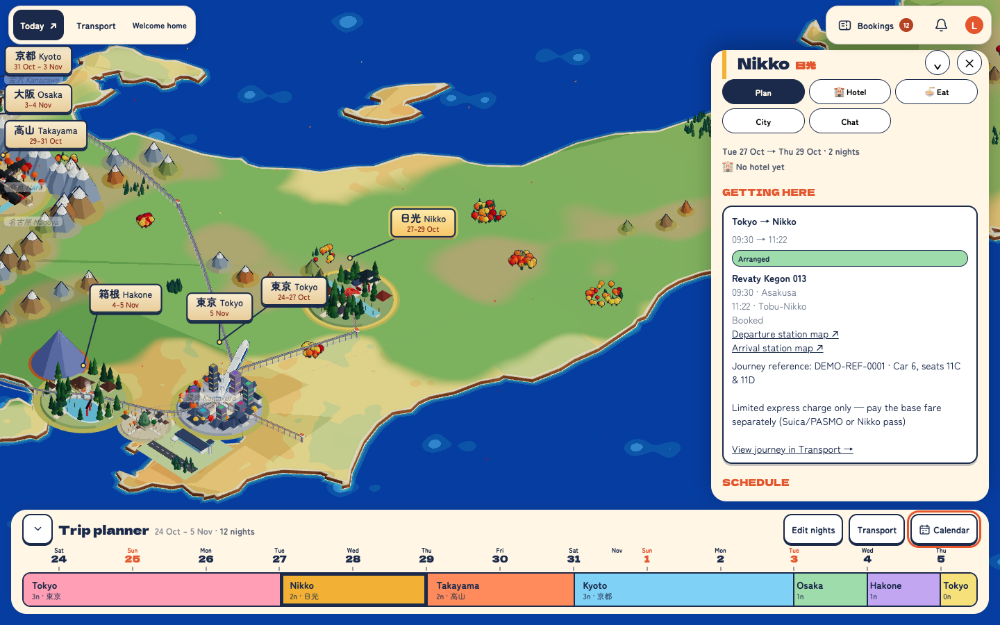
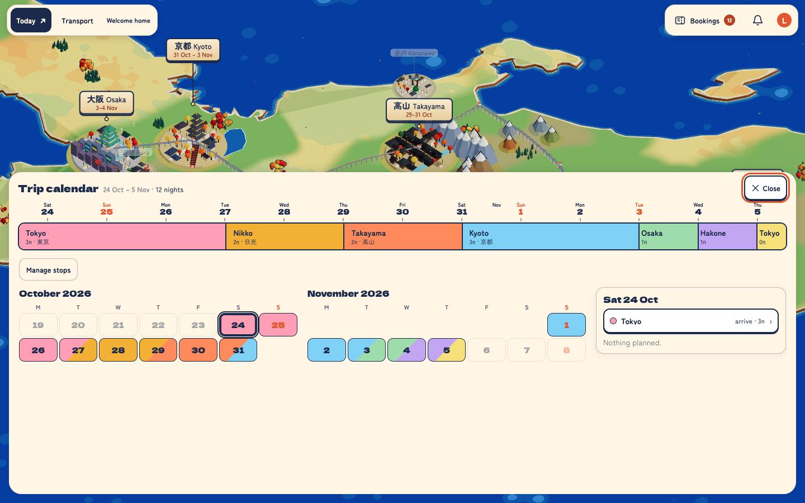
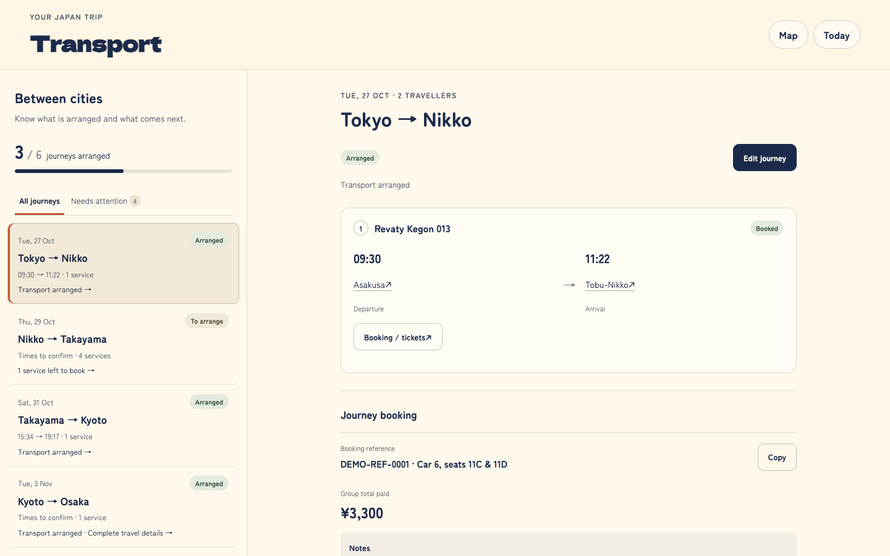
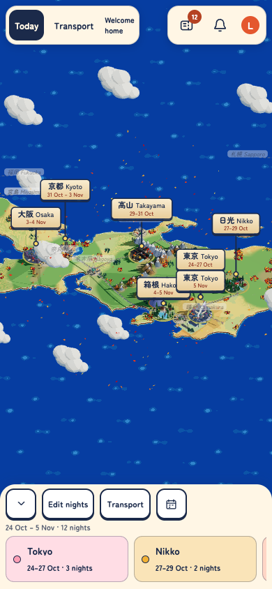

# Japan Trip Planner

A collaborative 3D trip planner built for a two-person trip around Japan. **Status: finished and archived.** The bundled trip data is demo content, not real bookings. The client is a React Three Fiber diorama of the country, with cities, rail network and a shinkansen. The server is Fastify with SQLite and WebSockets, so travellers edit one shared itinerary live.

## Screenshots



| City panel | Trip calendar |
| --- | --- |
|  |  |

| Transport workspace | Mobile |
| --- | --- |
|  |  |

Screenshots use the bundled demo data.

## Features

- **3D map**: stylised terrain, labelled cities, rail network, day-trip branches and a shinkansen that runs the route.
- **Trip planner bar**: a collapsible ruler from trip start to end with a block per stop. Drag the handle between blocks to move the shared depart/arrive date.
- **Calendar**: month grids, a day-detail card, and a stop editor to add, reorder and remove stops.
- **City panels**: plan, eat, hotel and city tabs, with activities, comments and reactions.
- **Today view**: the plan for the current day.
- **Transport workspace** (`/transport`): intercity journeys with services, transfer times, bookings and arrangement status. See [`web/src/transport/README.md`](web/src/transport/README.md).
- **Logistics drawer**: flights, legs, bookings board, checklist and weather (forecast, falling back to typical).
- **Collaboration**: live sync over WebSocket, presence, a "what's new" feed and unread tracking.
- **Auth**: one shared passphrase and a session cookie. Travellers pick a name.

## Requirements

- Node.js 22 or later
- npm

## Quick start

```bash
npm install
npm run dev
```

Open http://localhost:5173. The dev server uses a **mock API** by default, so no backend is needed.

To run against the real server:

```bash
npm start                      # Fastify on :3000 (dev passphrase: "japan")
VITE_API=real npm run dev      # Vite on :5173, proxies /api and /ws to :3000
```

## Scripts

| Command | Purpose |
| --- | --- |
| `npm run dev` | Vite dev server (root `web/`, port 5173) |
| `npm start` | Fastify server (`$PORT` or 3000). Serves `dist/` if built |
| `npm run build` | Typecheck (`tsc --noEmit`) then production build to `dist/` |
| `npm test` | Vitest suite |
| `npm run geo` | Regenerate `web/src/data/japan.json` from world-atlas |
| `npm run landmask` | Regenerate `web/src/assets/landmask.png` |

There is no linter; `npm run build` is the typecheck. Run a single test file with `npx vitest run --root . server/api.test.ts` (add `-t "name"` for one test).

`scripts/*.mjs` are Playwright e2e and screenshot scripts. They expect a server already running (for example `e2e.mjs` uses `localhost:3200`).

`?play=<part>` renders a scene part in isolation (see `web/src/dev/Playground.tsx`).

## Configuration

| Variable | Required in production | Description |
| --- | --- | --- |
| `SESSION_SECRET` | Yes | Signs the session cookie |
| `TRIP_PASSPHRASE` | Yes | Shared login passphrase (dev default: `japan`) |
| `DB_PATH` | Yes | SQLite file on a persistent volume, e.g. `/data/trip.db` (dev default: `./data/trip.db`) |
| `TRAVELLER_NAMES` | No | Comma-separated names (default: `Luke,Partner`) |
| `PORT` | No | Server port (default: 3000) |
| `VITE_API` | Build/dev | `real` uses the server API. Anything else uses the mock |

With `NODE_ENV=production`, the server refuses to start if a required variable is missing.

## Architecture

```
shared/   Types and API contract used by client and server (@shared/*)
server/   Fastify REST (/api), WebSocket (/ws), SQLite, weather, seed data
web/src/
  scene/  React Three Fiber diorama: terrain, cities, transport, camera, presence
  ui/     City panel, planner, calendar, logistics, transport workspace
  today/  Today view
  store.ts, timeline.ts, planner.ts, geo.ts, api*.ts, realtime.ts
scripts/  Geo data builders and Playwright e2e scripts
```

- **Contract**: `shared/types.ts` (`TripData`: trip, stops, legs, activities, flights, hotels and more) and `shared/api.ts` (`ApiClient`, `WsMessage`, `Collection`).
- **Server**: `index.ts` builds the app, `db.ts` wraps better-sqlite3, `realtime.ts` is the in-memory `Hub` (broadcast, presence, heartbeat), `weather.ts` and `seed.ts` supply forecasts and initial data.
- **Client state**: a zustand store holds `TripData`, selection and camera flags. WebSocket events upsert or remove entities in it. It is exposed as `window.__store` for debugging.
- **Timeline**: `timeline.ts` is pure and tested. `stateAt(data, hours)` gives position, vehicle and stop for an hour since `trip.startDate` 00:00 JST.
- **Planner**: pure logic in `planner.ts` (tested). Drag previews write both stops at once, and `saveStops.ts` saves them one by one and rolls back any that fail.
- **Geography**: `geo.ts` `toWorld(lat, lng)` maps to scene coordinates (x east, z south).

Contributor and agent guidance lives in [`CLAUDE.md`](CLAUDE.md).

## Deployment

The app is one Node process. Build with `npm run build`, then run `npm start` with the production variables above and a persistent volume for `DB_PATH`. Deploys are manual.

## Contributing

1. Branch off an up-to-date `main`. Don't commit to `main`.
2. Run `npm run build` and `npm test`.
3. Push the branch and open a pull request into `main`.

## License

[MIT](LICENSE)
